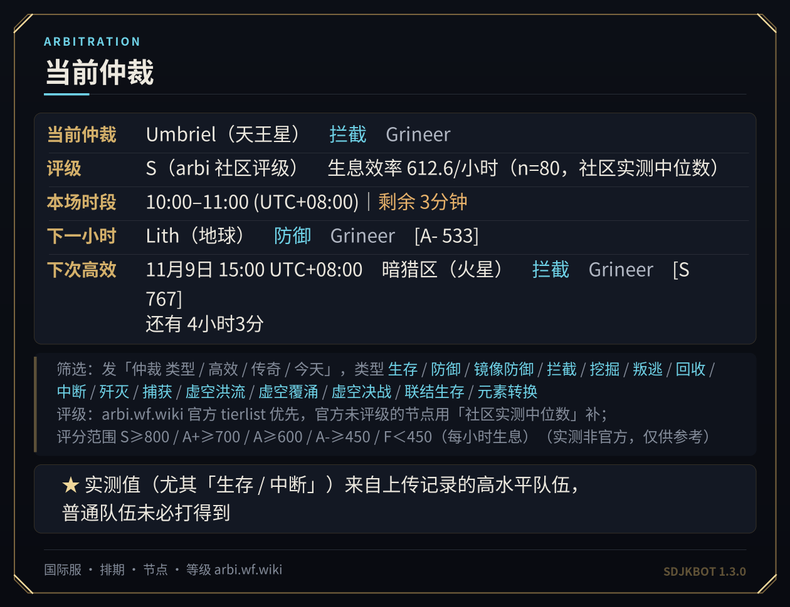
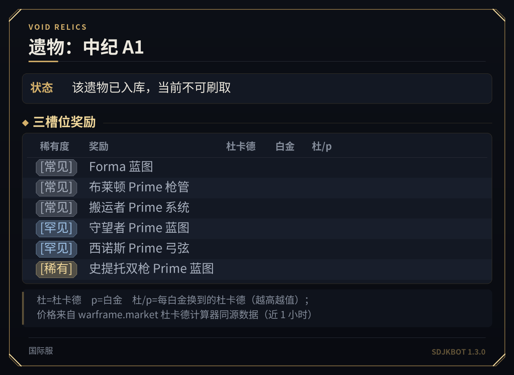
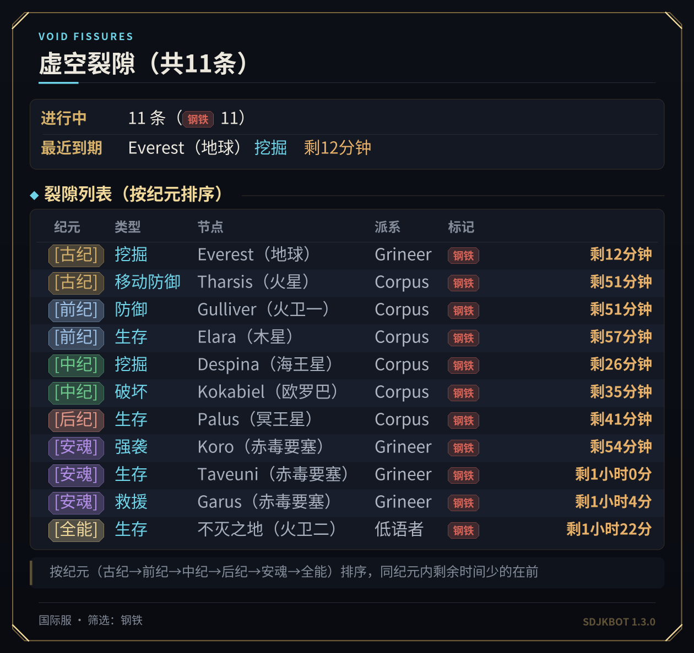
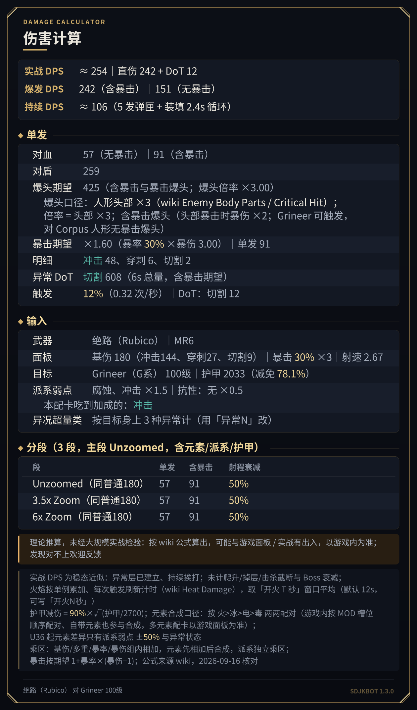
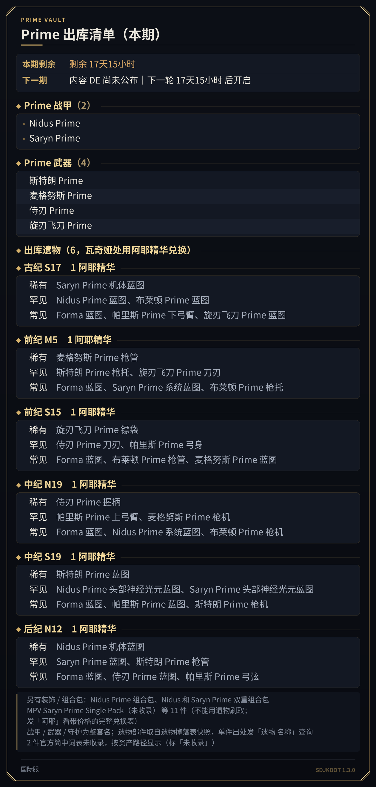
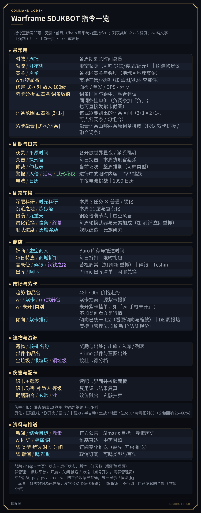
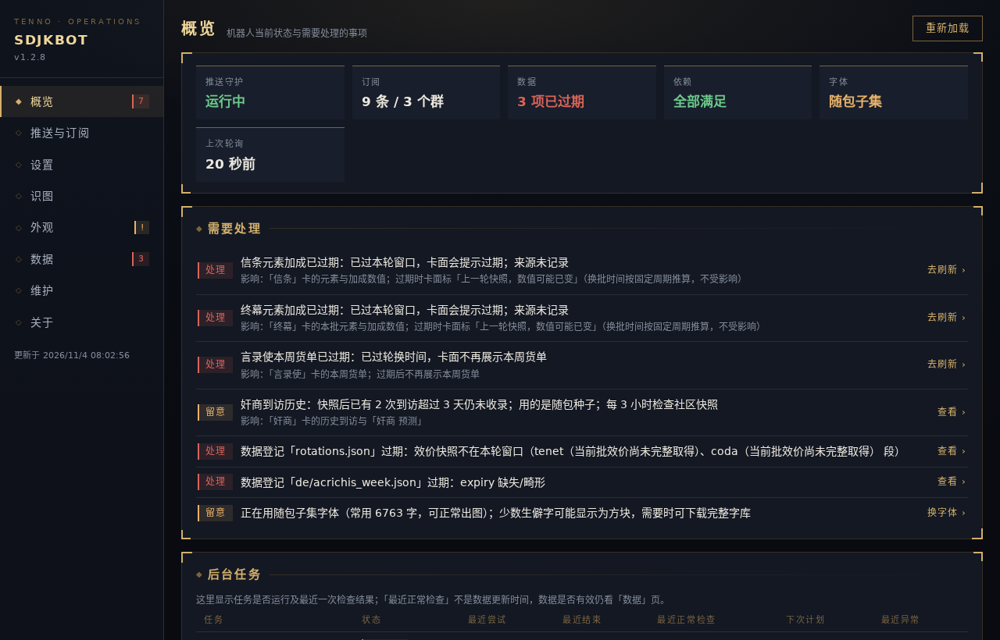
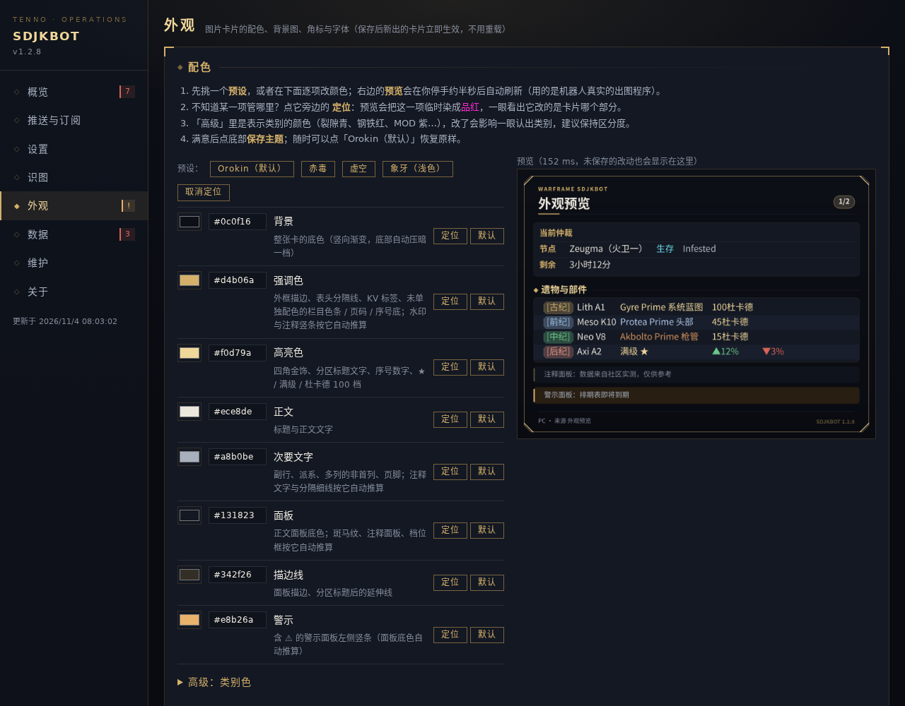
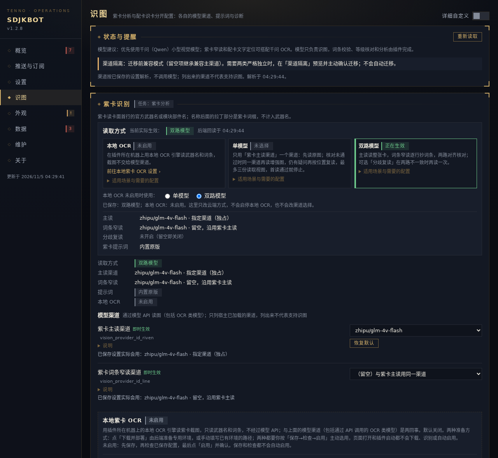

# AstrBot 插件 · Warframe SDJKBOT v1.3.0（`astrbot_plugin_warframe_sdjkbot`）

**简体中文** | [English](https://github.com/skyti1437/Warframe-SDJK-Bot/blob/main/README.en.md)

在 QQ 群（以及 Telegram、Discord、Slack、KOOK 等聊天平台）里查 Warframe 的一切：**世界状态、市场价、遗物与部件、伤害计算、配卡截图识别、紫卡分析、玄骸拍卖、奸商预测、蹲点推送**——
回复渲染成 Orokin 风格的图片卡片，后台还带一个可视化的运维面板。
回复可选**简体中文或英文**（国际服），英文模式下节点、任务、物品、武器、派系等优先使用 DE 官方英文名，详见下文「显示语言」。

指令是**自由参数式**的：`主指令 + 内容 + 附加项`，顺序随意、空格分隔。比如 `伤害 绝路 镀层3`、`遗物 出库`、`仲裁 生存 高效` 都行。
发送 `帮助` 查看完整指令表——共 **57 个主指令**，分 9 组。

---

## 卡片一览

| 当前仲裁（`仲裁`） | 遗物奖励（`遗物 中纪A1`） |
| :---: | :---: |
|  |  |
| **钢铁之路裂隙（`裂隙 钢铁`）** | **伤害计算（`伤害 绝路 镀层3`）** |
|  |  |
| **Prime 出库（`出库`）** | **指令一览（`帮助`）** |
|  |  |

> 示例用游戏快照和随包资料渲染，采用默认 Orokin 配色。卡片上的时间以 UTC+08:00 为例，安装后可在「设置 → 显示时区」调整。

## 功能

| 分组 | 代表指令 | 能做什么 |
| --- | --- | --- |
| 周期与日常 | `夜灵` `赏金` `裂隙` `突击` `执刑官` `时效` | 各开放世界昼夜、赏金与奖励、裂隙列表（可按钢铁 / 类型 / 纪元筛） |
| 任务与轮换 | `仲裁` `仲裁表` `深层科研` `沉沦之地` `侵袭` `九重天` | 当前与未来 14 天仲裁（带社区实测评级）、每周轮换 |
| 商店 | `奸商` `奸商 预测` `每日特惠` `言录使` `钢铁` `出库` | 虚空商人当期货单（按武器 / MOD / 外观等分组）与历史统计预测、Prime 出库与阿耶精华兑换 |
| 遗物与部件 | `遗物 <名>` `遗物 <部件>` `开核桃` `金垃圾` | 奖励、出处与当前可获取状态，部件反查推荐刷取点，杜卡德 / 白金性价比 |
| 市场与紫卡 | `wm` `wr` `rm` `趋势` `排行` `紫卡分析` `倾向` | warframe.market 在售 / 收购、紫卡拍卖、价格趋势、紫卡词条区间与评分 |
| 玄骸拍卖 | `xh <武器> [元素] [数值]` | 赤毒 / 信条 / 终幕 47 把武器，元素与数值筛选、卖家在线优先 |
| 伤害与配卡 | `伤害 <武器> <MOD…>` `识卡` `识卡伤害` | 按 wiki 口径算 DPS；发配卡截图自动识别并复算 |
| 推送 | `蹲 <事件> [条件]` | 裂隙、仲裁、警报、夜灵等事件出现时在群里提醒 |

几个值得单独说的：

- **玄骸拍卖**：中文名支持 `赤毒怒雷` / `赤毒·布拉玛` / `布拉玛` 等写法。warframe.market 没有挂单类目的武器（近战信条、全部终幕）会明确说明「只能游戏内交易」，不会报错。
- **紫卡拍卖（`wr`）**：词条可以写全称、简称或连写，`wr 冰凇 基础 多重 异常伤害 负i伤`、`wr 冰凇 基多异 负i` 查到的是同一组；英文写法不分大小写、全称不用加引号（`wr glaxion Critical Chance`、`CC` / `CD` / `MS`）。卡片顶部回显实际用了哪些词条。指定 `3+1`（或三正一负）时只给完全匹配的挂单，没有就直说；其他查询在没有完全匹配时给最接近的选项。
- **行情额度**：插件对 warframe.market 的所有访问——`wm` / `wr` / `xh` / `趋势` / 杜卡德、紫卡分析的同词条价格参考、排行与后台抓取——共用同一份额度：普通接口每秒低于 3 次、同时最多 3 个请求；拍卖搜索更严格，短时间内可连用两份，之后平均约 15 秒补回一份。`wr` 默认查升序和降序两份，紫卡分析的价格参考只查一次且失败不重试，`xh` 通常一次；缓存命中不占额度。额度忙时每次最多排队约 15 秒，仍排不上会提示繁忙（不代表没有挂单），有缓存照常返回；对方返回 429 或要求等待时按其时间暂停。这是本插件的保守节奏，参考 [warframe.market 接口规则](https://docs.warframe.market/docs/rules/overview/)，不是官方保证，本插件也不是官方授权或认可的客户端；多个插件实例或单独运行的维护脚本不合并额度。
- **排行刷新**：`排行`、`紫卡排行` 随时可查，`排行 进度` 只读看抓取进度；启动全量重抓（`排行 刷新`、`紫卡排行 刷新` 或后台按钮）只限管理员，两次重抓之间价格排行保护 30 分钟、紫卡现价 10 分钟，从上次开始和结束分别计算，失败、取消和自动批次也计入。耗时随候选数量、网络和共用额度变化，请看进度。
- **奸商预测**：基于 wiki 记录的 300 多次到访、460 多件商品做统计推测——按「已缺席次数 ÷ 它自己的平均上架间隔」排序。**这不是官方预测**（DE 从不公布下期库存），卡片上写明了口径和样本量。
- **伤害计算 / 识卡伤害**：按 wiki 公式计算，数据取自 DE 官方导出、warframe-public-export-plus 与英文 wiki，并以开源模拟器 [wfsim](https://github.com/magenie33/wfsim) 交叉核对。**这是理论推算，没有经过大规模实战检验**，可能和游戏面板或实战有出入，请以游戏内为准；卡片上也有同样的提醒。发现对不上的欢迎提 issue。
- **仲裁评级**：官方 tierlist 优先，没评级的节点用社区实测生息中位数补；样本少于 5 条的标 `*`。实测值来自高水平队伍，普通队伍未必打得到，卡片上也写了。

## 上手示例

装好后在群里直接发（不需要「/」前缀）：

| 发送 | 得到 |
| --- | --- |
| `帮助` | 全部指令一览 |
| `裂隙` · `裂隙 钢铁 生存` | 虚空裂隙；可按钢铁 / 任务类型 / 纪元筛选 |
| `仲裁` · `仲裁 生存 高效` | 当前与后续仲裁，带评级 |
| `遗物 后纪A2` · `遗物 绝路 枪机` | 遗物奖励与出处 / 部件出自哪些遗物 |
| `wm 水晶p` | warframe.market 在售单 |
| `伤害 绝路 镀层3` | 面板 / 单发 / DPS 与分段明细 |
| `.开启 推送`（群管理员）→ `蹲 钢铁t5歼灭` | 出现钢铁之路安魂歼灭裂隙时提醒一次 |
| `裂隙 -en` · `fissures` | 同一指令用英文回复 / 英文指令 |

## 显示语言（中文 / English）

回复语言按以下顺序决定：

1. **单条消息**：消息末尾加 `-en` 用英文回复，加 `-cn` 用中文回复，例如 `裂隙 -en`、`fissures -cn`。
2. **本会话**：群管理员发 `.语言 en` / `.语言 cn` 设定，`.语言 默认` 恢复跟随全局设置，只发 `.语言` 查看当前语言；英文写法为 `.language en` / `.language cn` / `.language default`。
3. **全局**：配置项 `default_language`（`cn` 默认 / `en`）。

设定会话语言需要群管理员或群主、AstrBot 管理员，或配置项 `super_admins` 里的用户，私聊同样如此；`-en` / `-cn` 任何人都能用。

- **英文指令**：`fissures`、`sortie`、`baro`、`arbitration`、`relic`、`damage`、`subscribe`、`wfhelp` 等（`帮助` 卡片的英文版列出全部写法），只在**消息开头**识别，避免把英文闲聊当成指令；中文指令照旧。`wm` / `wr` 还支持英文修饰词（如 `buy`、`max`、`radiant`、`offline`、`madurai`、`neg`）和英文物品名、部件名。
- **输入语言与回复语言分开**：用英文指令不会把回复切成英文；会话设为英文后，中文指令也用英文回复。`裂隙` 的英文筛选词（`steel`、`survival`、`axi` 等）在英文回复时识别，中文会话里请加 `-en` 或用中文筛选词；`仲裁`、`wm` / `wr`、`蹲` 的英文写法不受回复语言限制。
- **订阅**：每条订阅记住创建时的显示语言，之后按这个语言推送；v1.3.1 之前创建的订阅没有语言字段，按中文推送。
- **英文模式仍为中文的内容（v1.3.1）**：部分维基资料（简介、特性、建造材料）、部分遗物来源说明、部件名与刷取建议。

## 运维面板

在 AstrBot 后台的插件详情页打开「SDJKBOT 运维面板」（需要 AstrBot ≥ 4.24.1；只有登录后台的管理员能看到）。

| 概览 | 外观（配色、字体、实时预览） |
| :---: | :---: |
|  |  |



> 面板截图使用合成演示数据。

- **概览**：推送守护、订阅、数据、依赖、字体一眼看完，「需要处理」列出过期数据和该做的事，点一下就跳过去。
- **数据**页显示快照时间、状态和抓取进度。「重新加载」重读页面数据，「刷新社区快照」拉取较新的社区数据，「从源头重抓」立即从 wiki 重抓元素加成和言录使货单。价格排行和紫卡 WM 现价仍受上文所述的重抓保护。
- **推送与订阅**：按群查看「蹲」订阅（会话与订阅人标识默认打码），可删订阅、开关某个群的推送。
- **设置**：日常的输出、推送、平台与权限设置，每项标注「即时生效」还是「需要重载」；低频分组默认收起。
- **识图**：紫卡分析与配卡识卡分区显示，各自的模型渠道、生效状态与固定方案；「渠道隔离」显示迁移前兼容 / 已严格独立，并提供预览后主动确认的迁移与回滚；「详细自定义」开关展开旧配置兼容、完整路由、按任务的提示词编辑、同图对比和视觉诊断。本地紫卡 OCR 默认关闭、独立配置：可在紫卡区主动下载部署或手动填写路径，按「保存→检查→确认启用」选用，并上传一张截图做单次本地试识别。
- **外观**：
  - 卡片配色有 8 个基础色和 12 个类别色、4 套预设，每项都写明改的是卡片哪部分；
  - 「定位」按钮会把这一项在预览里临时染成品红，一眼看出它管哪里；
  - 支持背景图（可调压暗程度和面板透明度）和角标；
  - 字体可以从链接导入或上传，正文和粗体分别选；
  - 预览用的是真实出图程序，保存后新卡片立即生效。
- 在**维护**页可通过 AstrBot 的 pip 设置安装或修复 Python 依赖。本地紫卡 OCR 在「识图 → 紫卡识别」单独配置。「连通性」可测试当前世界状态源、社区数据、wiki 源页、warframe.market 和 FlareSolverr。数据新鲜度在「数据」页查看，识图渠道诊断在「识图 → 详细自定义」。

## 安装

1. 准备好 AstrBot（≥ 4.x）和消息平台适配器（NapCat / aiocqhttp 等）。
2. 在 AstrBot 插件市场搜索 **Warframe SDJKBOT** 安装；或者把本仓库放到 `data/plugins/astrbot_plugin_warframe_sdjkbot/`，再执行 `pip install -r requirements.txt`（只有 httpx 和 pillow 两个依赖）。
3. 重载插件，在群里发 `帮助` 试试。

**不需要额外操作就能出图**：插件自带常用 6763 字的中文字体。想让生僻字也能显示，到运维面板「外观」页点「下载完整字库」（约 40 MB），或导入任意你喜欢的中文字体。字体存在插件数据目录，插件更新不会丢。

## 配置

在 AstrBot 后台的插件配置页（或运维面板「设置」页）修改。常用的几项：

| 配置项 | 说明 |
| --- | --- |
| `default_language` | 默认显示语言：`cn`（默认）/ `en`；群内 `.语言` 覆盖，单条消息 `-cn` / `-en` 覆盖 |
| `display_timezone` | 回复、卡片与运维面板的显示时区。默认跟随 AstrBot 运行环境，可选固定 UTC 偏移（如 `UTC+08:00`、`UTC+05:30`）。订阅时间窗仍按北京时间填写 |
| `worldsource` | 世界状态数据源：`de` = DE 官方直连（默认）/ `warframestat` = 社区镜像 |
| `default_platform` | 默认平台 `pc` / `ps` / `xb` / `sw`（群里可用 `.默认平台` 覆盖） |
| `render_mode` | `image`（默认图片卡片）/ `auto`（长内容才出图）/ `text` |
| `super_admins` | 超级管理员的发送者 ID，不是群管理员也可以用管理指令 |
| `vision_provider_id` | 旧配置兼容主渠道；留空从已添加的视觉渠道自动挑选 |
| `vision_provider_id_riven` | 紫卡专用主读；迁移前留空沿用 `vision_provider_id`，主动迁移确认后留空即停止紫卡识别 |
| `vision_provider_id_line` | 紫卡逐行词条窄读；留空沿用紫卡主读；迁移前指定的渠道不可用时回落紫卡主读，迁移确认后不回落 |
| `vision_provider_id_scan` | 配卡识卡专用；迁移前留空沿用 `vision_provider_id`，主动迁移确认后留空即停止识卡 |
| `vision_provider_id_scan_equipment` | 配卡装备文字（可选）：只读装备区的名称、容量数字与面板文字；留空沿用配卡主读的首个渠道，指定后取不到不回落 |
| `vision_provider_id_line_recheck` | 紫卡分歧复读（可选，留空关闭）：主读完整但与窄读不一致时，最多同图再读一次；复读与主读逐项一致才采用，否则保留待核对结果 |
| `riven_single_ocr` | 紫卡单模型读取（默认关闭）：开启且本地 OCR 未启用时只用紫卡主读渠道读取，见「紫卡读取方式」 |
| `scan_detail_mode` | `auto`：有可用按钮则按需给详情；`lazy`：始终按需；`eager`：始终两页 |
| `flaresolverr_enabled` / `flaresolverr_urls` | FlareSolverr 开关与地址（可选，见下） |
| `community_data_url` | 社区数据地址，留空用本项目公开仓的 bot-data（见下） |
| `push_interval` / `proxy` / `http_timeout` | 推送轮询间隔与网络参数 |

### 视觉模型选型与独立配置

紫卡与配卡识卡可分别配置：两项专用主渠道都显式设置后，调整其中一项不会改变另一条路线；紫卡窄读还可另选渠道。迁移前（兼容模式）仍留空的项按上表回退，因此修改兼容主渠道会影响依赖它的项。后台「识图」页把紫卡与配卡分区显示，但分区本身只是界面组织；要让两类严格独立，需在「识图 → 渠道隔离」预览并主动确认迁移（见下文「紫卡与配卡渠道的主动迁移」），升级插件不会自动迁移。
紫卡主读与配卡识卡显式指定后只用所选渠道，取不到时停止本次识别，不改用其它渠道。

- **紫卡**：可在模型渠道里使用通过 API 调用的 OCR 类模型（如官方 Qwen-VL-OCR，与下文的本地 OCR 引擎不同）；已有稳定配置可继续沿用原通道和紫卡提示词。整屏配卡的表现不能替代紫卡验证。模型须按各自输出契约读清中文小字、词条正负号、小数点和百分号，以及卡面首行的官方武器名或模块部件名。模块化武器要读准首行官方腔体/部件中文名；名称后面的拉丁部分是紫卡词缀，不混入武器名；窄读另需遵守逐行词条输出契约。
- **配卡识卡**：需要更强的布局读取，完整覆盖多卡网格、姿态与特殊槽，区分已装卡和库存，并保持面板标签、数字及箭头两列对应。截图左上角的标题可能是玩家自定义的武器名，按原文读取，不根据 MOD 或紫卡名称推测官方武器。模型负责读字，等级与伤害由插件代码核算。配卡识卡不提供本地 OCR。

最低能力以任务契约与实际截图验证为准，不按参数量的 B 数设未经验证的门槛。接入新模型时，先用自己的截图分别验证紫卡与配卡，再选择各自渠道。


### 紫卡读取方式：本地 OCR / 单模型 / 双路模型

紫卡截图有三种读取方式。后台「识图 → 紫卡识别 → 读取方式」列出三者的说明、已保存的选择和**当前实际生效**的方式；实际生效按后端回读的本地 OCR 状态、已保存设置与路由解析推算，读不到或彼此对不上时显示「待确认」，不把未保存的草稿或旧缓存当作已生效。

| 方式 | 怎么读 | 适合 | 需要 |
| --- | --- | --- | --- |
| 本地 OCR | 插件所在机器上的本地 OCR 引擎读武器名和词条，截图不交给模型渠道 | 不想把紫卡截图发给模型服务商，或不想占用模型额度 | 按下文「本地紫卡 OCR」保存 → 检查 → 确认启用；外部引擎和模型由管理员下载或自备 |
| 单模型 | 只用紫卡主读渠道：先读原图，核对未通过时同一渠道再读增强图，仍有疑问再按位置复读；最多三份读取视图，首读通过即停止 | 有一个擅长读文字、兼容图片对话接口的模型渠道，想少配几个渠道 | 开启 `riven_single_ocr`，本地 OCR 未启用，并在 `vision_provider_id_riven` 明确选择渠道 |
| 双路模型 | 主读读整张卡，词条窄读逐行抄词条，两路对齐核对；可选分歧复读 | 沿用原有配置，或想给两步分别选模型（也可以是同一个模型） | 紫卡主读与词条窄读渠道（留空按上表回退） |

**优先级**：本地 OCR 已启用时总是走本地；本地 OCR 状态异常时也只走本地并停止，不转模型。否则 `riven_single_ocr` 开启走单模型，关闭走双路。单模型下紫卡主读留空、取不到或接口不兼容时直接停止并说明原因，不自动挑选，也不借用识卡或其它渠道；词条窄读和分歧复读不参与，已保存的值保留。识卡（配卡主读与装备文字）不受紫卡读取方式影响。

**提示词作用范围**：紫卡的两项提示词（紫卡主读 JSON、紫卡逐行窄读）只在双路模式下使用。单模型的首读与增强图不带文本提示词，位置复读使用内置提示词；本地 OCR 不用提示词。在单模型或本地 OCR 下保存或启用紫卡提示词，不会改变当前识别。

**切换**：单模型 / 双路在识图页选择后用保存条保存，保存成功即时生效、无需重载，页面随后重新读取后端状态确认；本地 OCR 只在本地 OCR 区块启停，选择单模型或双路不会安装、启用或关闭它。单模型不保证一次请求完成，也不代表准确率；本地 OCR 不把截图发给模型，但读取聊天图片、行情与资料仍按插件设置联网。

### 提示词草稿与同图对比

后台「识图 → 详细自定义」按「渠道 × 识别步骤」管理提示词（紫卡的两项只在双路模式下使用，见上节）：内置原版只读；复制原版后改写并「保存草稿」只是存档，线上照旧。「启用已保存草稿」和「恢复原版」是两个独立操作，各需再点一次确认；启用后只有该渠道的这一步改用草稿，恢复原版时草稿保留。固定方案可以查看和选择，查看、选择都不会启用。

「同图对比」用同一张 PNG / JPEG 图比较原版与候选提示词：「准备快照」只冻结图片和两侧提示词，不调用模型；再次确认「执行对比」后才把图片交给所选渠道，原版、候选各调用一次，同一快照只执行一次。这里的次数指插件对所选渠道的调用；模型 SDK 内部的 HTTP 重试与服务商计费不以此为上限。结果只说明能否按该步骤的格式解析，不判断读得对不对，也不会自动启用任何方案。

### 紫卡与配卡渠道的主动迁移

默认保留旧渠道配置，不在启动、刷新或读取状态时复制渠道或开启隔离。宿主首次加载新增 schema 时会补入 `vision_routes_isolated:false` 默认项；兼容与专用渠道值不变。后台「识图 → 渠道隔离（主动迁移）」显示当前是迁移前的兼容模式还是已严格独立；打开页面、读取状态或升级插件都不会迁移，页面分区本身也不代表已经迁移。点「预览迁移」只生成预览（列出保留的值、将复制的值和确认后留空即停止的规则，不写配置、不调用模型），再点「确认迁移」才写入；预览约 180 秒内有效、只能确认一次，识图页有未保存的渠道改动时不能确认。管理员须先核对预览，再主动确认：只把明确配置且可用的旧兼容渠道复制到留空专用项，已有专用项和旧兼容值保留；若旧配置依靠自动枚举、或渠道不可用，要求先手动选择，不代猜渠道。

确认后启用 `vision_routes_isolated`：紫卡与配卡只认各自专用渠道，留空则停止该任务，不再继承兼容主渠道；紫卡窄读留空只可沿用紫卡自己的专用主读，显式选择但不可用时不回落。两任务分别记录发送者冷却和失败退款，结果快照仍属于识卡；机器总并发预算继续共享（忙时两类仍可能互相等待），紫卡每次识别请求单独占位，覆盖该次完整读取流程。回滚同样需要预览和确认，只关闭隔离标记，不删除旧值或新选择。

迁移预览不调用模型、不写配置。配置或渠道可用性变化、预览过期、正在保存或识图（busy）、写盘失败时都不会生效，页面要求重新预览，不自动重试；成功后以重新读取的状态与路由为准。普通设置保存不能直接切换迁移状态，保存设置也会作废未确认的预览。迁移与回滚都不触碰本地 OCR 的开关、安装、模型路径或试识别。迁移接口与配置写入依据见 `core/webpanel.py`，路由和占位回归见 `tests/test_vision_migration.py`、`tests/test_vision_isolation.py`。本地紫卡 OCR 的默认关闭及失败不转云规则独立保留。

### 本地紫卡 OCR（默认关闭）

本地紫卡 OCR 已提供独立后端，只读取武器名和词条，不经过模型 API，也不用于配卡识卡。默认关闭；打开后紫卡图片只走本地路径，缺件、超时或识别不完整都会提示，不自动改走云端。关闭后沿用原有紫卡模型渠道配置。

部署管理、隔离识别进程与紫卡解析规则是插件自有代码，随源码按 GPL-3.0 公开；RapidOCR、ONNX Runtime 等第三方引擎、依赖 wheel 和模型文件**不随插件包分发**，由管理员在后台主动下载到独立环境或自行准备，各自适用其上游许可。

**使用顺序**：准备环境和模型（两种方式，见下）→ 后台「识图 → 紫卡识别 → 本地紫卡 OCR」选择 RapidOCR，填写容器内可见的解释器和模型绝对路径 → 保存（会关闭 OCR 并清除旧检查）→ 检查已保存配置（只核对解释器、依赖版本、模型 SHA256 和资源，不加载模型、不识别）→ 点「启用」并再次确认。部署成功、检查通过或目录里已有模型，都不会自动保存或启用。修改路径、离开页面、页面隐藏或配置变化，都会让待确认的操作作废。

**准备方式（二选一）**：

- **后台下载部署**：在同一区块点「下载并部署本地 OCR」，再点一次确认。后端在插件所在机器按冻结清单下载依赖和模型、逐个核对 SHA256，再创建专用 Python 环境；页面显示任务状态、进度和完整错误。自动部署只支持 Linux x86_64 / CPython 3.12，由后端按插件的运行环境判断，与浏览器所在系统无关；其它平台会显示「当前平台自动部署不支持」，请改用手动准备。每次确认只提交一次：失败不会自动重试、删除目录或重装，要再次点击确认；已有任务在运行时再次提交会被拒绝，这不是安装失败。成功后点「填入推荐路径」：推荐的解释器和模型目录只写进表单草稿，仍要你保存、检查并确认启用。
- **手动准备**：自备专用 Python 环境和模型，直接填写路径。不要把依赖装进 AstrBot 的 Python 或系统全局环境。

插件启动、打开页面和读取状态都不会下载资源或识别。维护页的「一键安装插件依赖」只安装 `requirements.txt` 里的插件依赖，不包含本地 OCR 组件。

**试识别**：启用后，可以在同一区块上传一张紫卡截图（PNG / JPEG / WebP，不超过 10 MiB），再点一次确认，插件所在机器执行一次本地识别。页面只显示武器名、词条、识别状态和原因：不调用模型 API、不估价、不查询市场，也不发到聊天。选图和预览都不识别，图片不写入浏览器存储。

冻结资源清单见 `core/data/local_ocr_assets.json`：包含 Linux x86_64 / CPython 3.12 的 25 个 wheel（逐项版本、官方 PyPI URL 与 SHA256）及以下 3 份模型。其它平台的自动安装未提供。手动环境检查要求 RapidOCR 3.10.0、ONNX Runtime 1.31.1；其它平台和版本需另行验证，不能套用 Linux wheel。

| 模型文件 | SHA256 |
| --- | --- |
| `PP-OCRv6_det_small.onnx` | `090f04abcd9d9a7498bc4ebf677e4cb9bdce1fe4197ddb7e529f1ef44e1ff94f` |
| `PP-OCRv6_rec_small.onnx` | `6f327246b50388f3c176ae304bd95767ea6dc0c9ae92153ef8cbe210b3c14884` |
| `ch_ppocr_mobile_v2.0_cls_mobile.onnx` | `e47acedf663230f8863ff1ab0e64dd2d82b838fceb5957146dab185a89d6215c` |

模型地址及 SHA 来自 RapidOCR 3.10.0 自带的 `default_models.yaml`，下载源为 RapidAI 在 ModelScope 的对应版本。手动准备时请按冻结清单下载、用 `sha256sum` 核对，依赖仅从匹配平台的已核验 wheel 离线安装；不要让 pip 临时解析最新版本。

环境与模型应位于持久数据目录，例如容器内 `/AstrBot/data/plugin_data/astrbot_plugin_warframe_sdjkbot/riven-ocr/`：`runtime/bin/python` 是独立解释器，`models/` 放上述模型。模型不能放进插件源码目录。宿主机路径必须先挂载进容器，后台填写容器里实际可见的绝对路径。自动安装不会覆盖已有环境；失败时保留诊断，不删除用户目录、不自动重试重建。

识别使用 CPU（线程 2/1），同一时刻只运行一张图，每次调用独立进程并在结束时回收；超时上限 45 秒，图片限制 10 MiB / 2400 万像素。资源预检要求可用 RAM 至少 256 MiB，且可用 RAM 加空闲 swap 至少 1024 MiB，并受容器配额收紧。此门槛用于拒绝明显不足的环境，不是性能保证；swap 可以缓解内存压力，也可能增加磁盘等待。

只有 `accepted` 的结果才会在聊天里继续估价。聊天中结果为 `partial` 且读到词条时，列出武器名和词条供核对；其它情况提示原因。后台试识别对 `partial`（部分识别）和 `rejected`（未采信）都展示已读到的字段和原因，缺的字段标为未识别。这些结果都不进入估价，也不改用模型渠道；核对后可以发送文字紫卡分析指令。已测样本的结果不代表所有新图，整屏配卡识卡仍需另行验证。实现与检查依据：`core/local_ocr.py`、`core/local_ocr_worker.py`、`core/local_ocr_install.py` 及 `tests/test_local_ocr*.py`。

### 数据怎么保持新鲜

- **实时数据**直接查官方或社区接口：世界状态、市场价、仲裁排期等。
- **信条／终幕效价**只随包保留商品与轮换规则；首次启动立即在后台获取，数值缓存到运行目录。获取前卡面提示尚未取得，失败后自动重试；升级保留已有缓存并继续提示时效。
- **言录使当周货单**也不随包提供；只保留候选商品、参考价目和周重置规则。首次启动在后台取得当周商品名单，价格按目录补齐；取得前明确显示货单待获取与候选池，请以游戏内为准。
- **效价、言录使货单与轮换修订**先用普通 HTTP 直连 Wiki；遇到拦截或无效内容，按开关决定是否尝试 FlareSolverr，再使用社区快照。关闭 `flaresolverr_enabled` 只禁用浏览器代理，直连与社区更新继续。上游限流时先退避。
- **社区快照（零配置）**发布在本仓库的 [`bot-data` 分支](https://github.com/skyti1437/Warframe-SDJK-Bot/tree/bot-data)。效价依次尝试 Raw、GitHub Contents API 和 CDN，旧内容会让位给下一个来源；只有内容与轮换时效合格且不倒退的数据才采用。社区更新不依赖本机浏览器，所有来源不可用时保留本地值并提示时效。
- **FlareSolverr（可选兜底）**：部署后填入 `flaresolverr_urls`。插件在容器中时，填容器名（如 `http://flaresolverr:8191`）或 Docker 网关；`127.0.0.1` 通常连不到宿主机。
- 不想用本项目的数据，可以在 `community_data_url` 填自己的地址：在那个地址下放同名文件（`valence.json`、`arb_ratings.json` 等），格式与 bot-data 分支一致。
- 其余随包数据（武器 / MOD 数值、掉落表、中文译名等）随插件版本更新。

### 平台与按钮

QQ 官方群的按钮只填入输入框，用户再发送；官方私聊执行按钮可直接发送。游戏密语只用于复制到游戏。Telegram 可执行按钮、并在 SDK 支持时原生复制；Discord、KOOK、Slack Socket 可执行按钮，无法等价提供的操作显示文字入口。Slack Webhook 模式只有文字输出；飞书及其它未接通回调的平台使用文字/图片，NapCat 保持原有指令与 `-r` 密语。

**指令菜单（v1.3.1）**：AstrBot 支持指令注册时，插件注册 19 条英文指令（`/fissure`、`/sortie`、`/baro`、`/arbi`、`/wm`、`/wr`、`/relic`、`/damage`、`/subscribe`、`/wiki`、`/wfhelp` 等），由 AstrBot 同步到 **Telegram** 指令菜单和 **Discord** 斜杠指令，每条只回复一次。**QQ 官方机器人**不能自动同步：发送 `.菜单`（`.menu`）取得录入清单，由管理员在 QQ 开放平台管理端「高级设置」里按清单录入（指令类型选「指令」）；点选后指令填进输入框，带参数的补上名称再发送，群聊需要 @机器人。

识卡默认按平台按钮能力选择按需详情或原有两页；`scan_detail_mode` 可强制指定。第一页仍计算参考伤害，省去的是再次详情计算、绘图与上传。每份识卡记录绑定会话和原发送者，30 分钟后失效，旧按钮不会改用新卡。Telegram 话题、Slack 线程保留回复位置。非 QQ 平台需使用者在自己的账号下完成交互验收。

部署注意：

- **QQ 官方机器人**：按钮和「图片和按钮合并发送」都是 Markdown 消息，不支持 Markdown 的旧版 QQ 客户端可能无法正常显示，合并消息中的图片也可能受影响；遇到此情况可关闭 `qq_merge_image_actions`（图片改为普通图片单独发送）和 `qq_markdown_cards`（文字卡改发纯文字）。按钮与 Markdown 只在平台类型为 `qq_official`（WebSocket 接入）时启用；`qq_official_webhook` 接入仍是文字与图片输出。
- **Telegram**：「/」指令菜单里是上述 19 条英文指令；其余指令（中文或英文）作为普通消息发送。在群里直接发送这类指令时，在 BotFather 用 `/setprivacy` 关闭隐私模式，或把机器人设为群管理员。隐私模式开启时，普通群消息不会完整送达；可接收明确发给该机器人的命令（如 `/fissure@机器人用户名`）、满足条件的普通命令、通过该机器人发送的消息及相关回复，详见 [Telegram 官方 FAQ](https://core.telegram.org/bots/faq#what-messages-will-my-bot-get)。
- **Discord**：AstrBot 的 Discord 适配器会申请 Message Content 与 Server Members 两个特权 intent，需先在 Discord 开发者后台的 Bot 页面开启，否则网关会拒绝连接。上述 19 条菜单指令会出现在斜杠指令里；其余指令在频道里按 AstrBot 的唤醒前缀直接发送。
- **Slack**：默认输出文字卡（AstrBot 的 Slack 适配器上传图片尚不稳定：上传失败时整条消息会丢失）；指令加 `-t` 可强制出图，此时应用需要 `files:write` 权限。按钮需要 Socket 模式（Webhook 模式只有文字）。应用至少需要 `chat:write` 权限，Socket 模式的应用级令牌需要 `connections:write`。Slack 客户端会把「/」开头的消息当作斜杠命令，频道里请用「@机器人 指令」，私聊可直接发指令。

## AI 相关说明

**插件本身不内置任何模型，也不代持任何 API Key。**

| 场景 | 用 AI 做什么 | 由谁提供 |
| --- | --- | --- |
| 识卡 / 紫卡截图识别 | 读取名称、容量/词条和面板；等级与伤害由插件核算 | 你在 AstrBot 里配置的多模态模型 |
| 推荐 / 攻略类问答 | 走 AstrBot 平台的 LLM + 知识库 | AstrBot 平台，插件不参与 |

需要自己添加多模态渠道，再分别选择紫卡与配卡的专用配置。紫卡主读或配卡识卡显式指定后只用所选渠道；留空按上表兼容回退，回退到未指定的兼容主渠道时才自动挑选已添加的视觉渠道。插件会核对识别结果；模型能返回文字，不代表装备和数值已完整读对。

**开发过程**：这个项目的绝大部分代码是在 AI 辅助下完成的。由作者（Sky）提需求、提供截图和实测反馈，AI 负责写代码、核对数据、写测试和文档。所以代码里有大量「为什么这么写」的注释和防回归测试，用来弥补 AI 改动容易引入静默回归的问题。

## 隐私

- 插件只在你自己的机器人上运行，不向任何第三方上报数据，所有查询都直接发给下表的公开数据源。
- 运行数据（群配置、订阅、外观设置、渲染缓存）写在 `data/plugin_data/astrbot_plugin_warframe_sdjkbot/`，不会进仓库。
- 使用模型读取方式时，识卡或紫卡会把**你发的截图**交给对应任务配置的模型服务商；启用本地 OCR 时，紫卡读取在插件所在机器完成，读取失败不会改用模型。需要使用本地部署或自建的模型服务时（属于模型渠道），请明确选择对应渠道，并按当前读取方式核对留空项的行为；双路兼容模式下的自动选择可能使用多个已添加的视觉渠道。
- 读取聊天里的图片时有大小、超时与跳转次数限制；每一跳按实际域名决定是否带 QQ 请求头，不向非 QQ 地址携带 QQ Referer。个别图床或外链可能读取失败，请直接发送原图。
- 识卡对齐失败时**默认不留存截图**；只有在配置里开启 `scan_debug_save` 才会把截图存到运行目录的 `scan_debug/`（最多 3 张，可直接删除）。
- 运维面板只有登录 AstrBot 后台的管理员能打开；订阅里的会话与订阅人标识（群号、QQ 号或平台 OpenID）默认打码。

## 数据来源与许可

| 数据 | 来源 | 说明 |
| --- | --- | --- |
| 世界状态 | DE 官方 `api.warframe.com` | 实时接口 |
| 掉落表 | [WFCD/warframe-drop-data](https://github.com/WFCD/warframe-drop-data) + DE 官方掉落页 | MIT |
| 物品 / 武器基础面板 | [WFCD/warframe-items](https://github.com/WFCD/warframe-items)（MIT）+ DE 官方 Public Export | 数据源头为 DE |
| MOD 等级与逐级数值 | DE 官方 Public Export（`ExportUpgrades`） | 数据源头为 DE |
| 武器攻击形态、灵化形态与进化、CO 分类、回响加成、Archgun 面板 | [wiki.warframe.com](https://wiki.warframe.com) 的武器数据模块、各武器灵化页与「Condition Overload (Mechanic)」攻击目录 | CC BY-NC-SA 3.0；各文件 `_meta` 写明 wiki 快照 |
| MOD 互斥 / 条件叠层 / 不兼容武器 | 英文 wiki `Module:Mods/data` + DE 官方 Public Export + [warframe-public-export-plus](https://github.com/calamity-inc/warframe-public-export-plus) | CC BY-NC-SA 3.0 / MIT |
| 常用敌人数值 | 英文 wiki `Module:Enemies/data` + [warframe-public-export-plus](https://github.com/calamity-inc/warframe-public-export-plus)（wiki 未写的护盾 / 护甲） | CC BY-NC-SA 3.0 / MIT |
| 中文译名 | DE 官方 Public Export（经 [warframe-public-export-plus](https://github.com/calamity-inc/warframe-public-export-plus) 整理） | 数据源头为 DE |
| 紫卡词条池（「词条范围」可出词条） | DE 官方 Public Export + [warframe-public-export-plus](https://github.com/calamity-inc/warframe-public-export-plus)（词条正负与限制）+ 自有 warframe.market 挂单抽样 | MIT / 数据源头为 DE |
| 市场价 / 拍卖 | warframe.market | 所有查询与后台抓取共用一份额度：普通接口低于 3 次/秒，拍卖搜索更严格；遇 429 或 `Retry-After` 暂停（见上文「行情额度」） |
| 赏金轮换 / 钢铁侵袭 | [browse.wf](https://browse.wf) | calamity-inc 开源项目 |
| 仲裁排期与社区实测 | [arbi.wf.wiki](https://arbi.wf.wiki) | 社区站点，非官方 |
| 元素加成、奸商历史、资料卡文本（简介 / 效果 / 获取，经摘录、翻译与重排）、紫卡取消前的旧倾向（只用于识别旧截图；游戏内倾向自 2026-10 起统一为 1.2，插件按 1.2 计算） | [wiki.warframe.com](https://wiki.warframe.com) | [CC BY-NC-SA 3.0](https://creativecommons.org/licenses/by-nc-sa/3.0/)；仅这些数据适用，代码另按 GPL-3.0 |
| 字体 | Noto Sans CJK SC 子集（© Adobe） | SIL OFL 1.1，全文与子集化说明见 `core/data/fonts/OFL.txt` |

- **算法参考**：赏金「小帐篷」推算参考了 [calamity-inc/wf.browse.oracle](https://github.com/calamity-inc/wf.browse.oracle) 公开的算法（种子与洗牌步骤与其一致）。该仓库没有附带许可证；本插件用 Python 另行实现，没有拷贝其源代码文件。
- **伤害计算**：以 [magenie33/wfsim](https://github.com/magenie33/wfsim)（AGPL-3.0-or-later）为对照基准交叉核对公式，未复制其源代码。早期版本的部分派生数据表取自其整理的数据，**v1.2.7 起改为从上表所列来源重新生成**（生成器见 `scripts/build_*.py`），wfsim 只作交叉核对。例外：MOD 等级表里 4 张卡的少量字段（晕眩弹药的触发几率、三张半自动炮轰的卡面说明）DE 原文没能解析成计算字段，沿用旧表并在数据里标 `_legacy_fields`（数值与 DE 原文一致）；Primed Deadly Efficiency 的持续时间 wiki 写 16.5 s、DE 写 17 s，暂未裁定，标 `pending`。
- **插件图标**：按作者记录取自 Warframe 官方 Fan Kit 素材（`LotusEmblemIcon`），版权归 Digital Extremes，用于本非商业粉丝作品，不表示与 DE 有关联或经其认可。
- **代码许可**：GPL-3.0（见 `LICENSE`）。
- **非官方声明**：Warframe 与相关商标、游戏图标、名称与译文归 Digital Extremes 所有。本插件是粉丝作品，与 Digital Extremes 无关。

### 第三方许可声明（MIT）

随包数据有一部分由以下 MIT 许可项目的导出整理而来，按其许可附上版权与许可声明：

- [WFCD/warframe-items](https://github.com/WFCD/warframe-items)：Copyright (c) 2017 Kaptard
- [calamity-inc/warframe-public-export-plus](https://github.com/calamity-inc/warframe-public-export-plus)（固定提交 `513105d`）：Copyright (c) 2024-2026 Calamity, Inc.；Copyright (c) 2026 AMelonInsideLemon

```text
MIT License

Copyright (c) 2024-2026 Calamity, Inc.
Copyright (c) 2026 AMelonInsideLemon

Permission is hereby granted, free of charge, to any person obtaining a copy
of this software and associated documentation files (the "Software"), to deal
in the Software without restriction, including without limitation the rights
to use, copy, modify, merge, publish, distribute, sublicense, and/or sell
copies of the Software, and to permit persons to whom the Software is
furnished to do so, subject to the following conditions:

The above copyright notice and this permission notice shall be included in all
copies or substantial portions of the Software.

THE SOFTWARE IS PROVIDED "AS IS", WITHOUT WARRANTY OF ANY KIND, EXPRESS OR
IMPLIED, INCLUDING BUT NOT LIMITED TO THE WARRANTIES OF MERCHANTABILITY,
FITNESS FOR A PARTICULAR PURPOSE AND NONINFRINGEMENT. IN NO EVENT SHALL THE
AUTHORS OR COPYRIGHT HOLDERS BE LIABLE FOR ANY CLAIM, DAMAGES OR OTHER
LIABILITY, WHETHER IN AN ACTION OF CONTRACT, TORT OR OTHERWISE, ARISING FROM,
OUT OF OR IN CONNECTION WITH THE SOFTWARE OR THE USE OR OTHER DEALINGS IN THE
SOFTWARE.
```

---

<details>
<summary><b>开发与维护</b></summary>

开发与维护请先通过 `git clone https://github.com/skyti1437/Warframe-SDJK-Bot.git` 获取完整仓库，
其中包含测试、构建脚本和展示图片。市场安装包及 GitHub 的 Download ZIP 按运行文件范围归档。

改任何公式或版式之前，先跑统一检查入口（本地和 CI 是同一条命令）：

```bash
pip install -r requirements.txt -r scripts/requirements-dev.txt
python scripts/run_checks.py          # regression（默认）：ruff + 全部 tests/test_*.py + 伤害审计
python scripts/run_checks.py health   # 随包效价骨架与言录使静态目录完整性（只读、不联网）
```

- regression 红 = 代码回归；health 红 = 随包骨架或静态目录不合规；效价与言录使当周货单不回填种子。运行期缺值或过期仍由后台健康检查提示。CI 在 push / PR 上跑 regression（Python 3.10 与 3.12），health 在 Actions 页手动触发。
- 测试按 `tests/test_*.py` 自动发现、每个脚本独立运行；缺能力（例如不带完整字库、没有作者私有的运维脚本）时会明确打印跳过原因，不会静默。
- `scripts/` 下是数据构建、排障和版式开发工具，插件运行不需要它们：
  - 数据构建：`scripts/build_*.py`（从 WFCD / DE 导出 / warframe-public-export-plus / 英文 wiki 快照重新生成 `core/data/`，只用标准库；输入快照路径作参数传入，多数带 `--check` 可复现校验）；
  - 排障：`scripts/diag_command_output.py "遗物 出库"`（在 AstrBot 容器里直接打印指令的真实返回）、`scripts/smoke_all.py`；
  - 版式：`scripts/dev_relic_preview.py`、`scripts/dev_help_preview.py` 等，本地预览卡面。
- 版本历史见 [`CHANGELOG.md`](CHANGELOG.md)（也是插件面板与市场「更新日志」页的数据源）。

</details>
